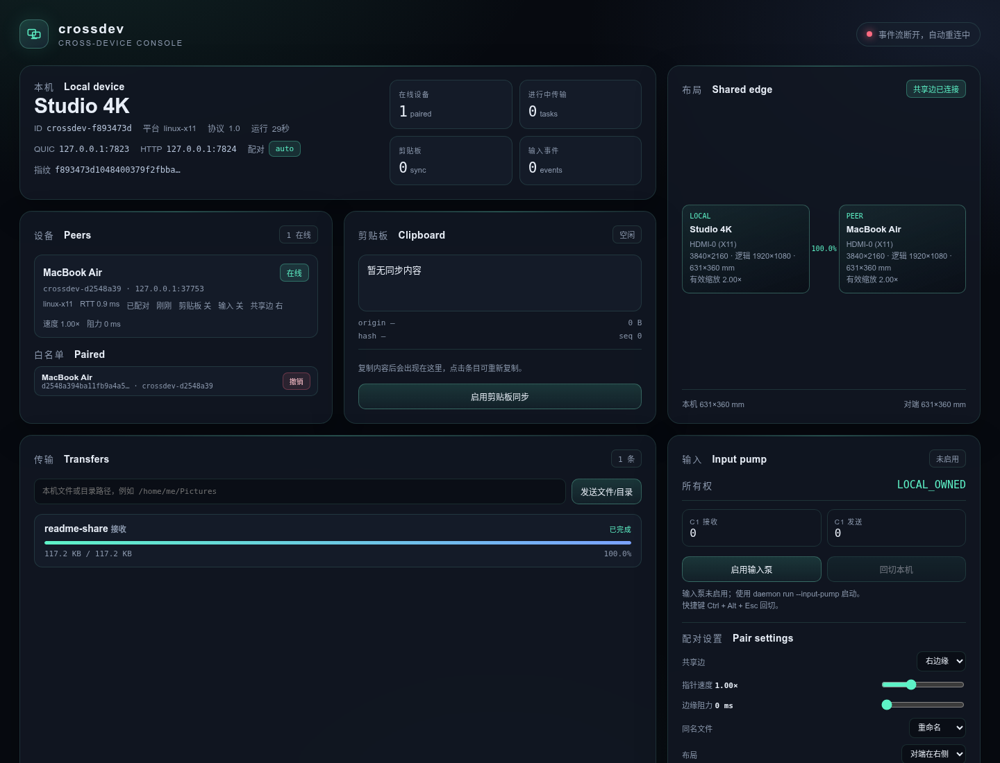
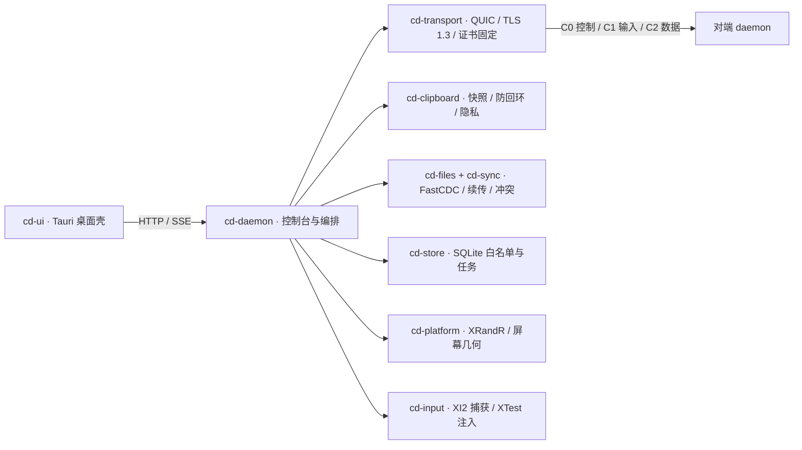
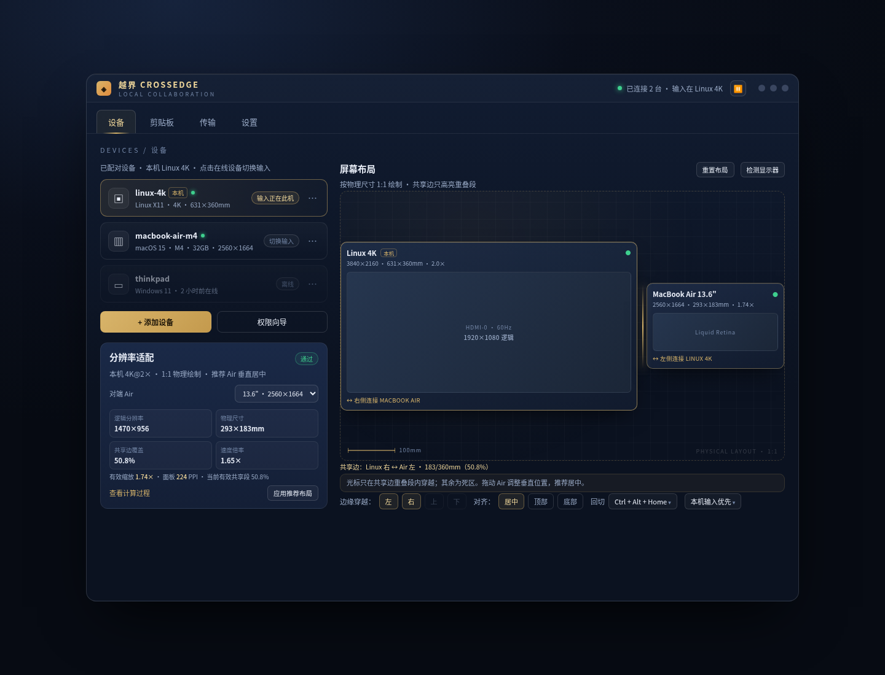

# CrossDevice

**跨设备协同套件 · Rust + QUIC · 跨屏输入 / 剪贴板 / 文件传输**

一套面向局域网的多机协同工具：把另一台电脑的屏幕接在你的屏幕边缘，让鼠标键盘、剪贴板和文件像在本机一样流动。传输链路使用 QUIC 双向 TLS、证书指纹固定和 6 位 SAS 人工配对，不依赖公网中继。




> 上图是实际控制台截图：两台 daemon 完成配对后，传输面板显示已完成的目录任务，白名单区块可查看并撤销已配对设备。

## 特性

| 模块 | 能力 | 状态 |
|---|---|---|
| 配对与发现 | UDP 广播发现、主动地址、SAS 6 位码人工批准、证书指纹固定 | ✅ Linux 实测 |
| 跨屏输入 | X11 XI2 捕获、XTest 注入、按物理 mm 映射、边缘穿越与 750ms 回切、拖拽时禁止穿越 | ✅ Linux X11 |
| 剪贴板 | 文本 / 图片 / 文件列表 C2 同步、防回环、历史、密码管理器排除 | ✅ Linux 实测 |
| 文件传输 | FastCDC 分块、BLAKE3 块去重、断点续传、原子落盘、同名策略 rename/overwrite/skip/ask | ✅ Linux 实测 |
| 传输控制 | 进行中/暂停/继续/取消、C0 双向状态同步、取消后清理 `.cdpart` | ✅ Linux 实测 |
| 布局编辑 | 毫米坐标、左右共享边、间隙、覆盖率与速度倍率、`LayoutSet` 同步 | ✅ Linux 实测 |
| 设备管理 | 白名单查看、撤销设备并立即断开会话 | ✅ Linux 实测 |
| 桌面壳 | Tauri 2 原生窗口承载控制台；无 daemon 时自动拉起 | ✅ Linux 实测 |
| 安装包 | Debian 包（daemon + 桌面壳 + systemd 用户服务） | ✅ 已构建 |
| macOS / Windows 输入后端 | CGEventTap / SendInput + 低级钩子 | ⏳ 环境受限，见「已知限制」 |
| Wayland | portal + libei | ⏳ 未实现 |

## 架构



### 通道

| 通道 | 载体 | 内容 |
|---|---|---|
| C0 | QUIC stream | Hello、配对、布局、心跳、文件通道仲裁、传输暂停/取消 |
| C1 | QUIC DATAGRAM | 鼠标/键盘事件（20 字节，不重传） |
| C2 | QUIC stream | 剪贴板 blob、manifest、chunk map、文件块 |

### Workspace

| crate | 职责 |
|---|---|
| `cd-geometry` | 物理 mm 布局、共享边计算、DPI / 速度换算（纯函数） |
| `cd-proto` | 协议类型、C0/C1/C2 帧、错误码 |
| `cd-transport` | quinn、rustls、双向 TLS、证书固定、SAS |
| `cd-input` | X11 捕获与注入（Windows/macOS 后端待补） |
| `cd-clipboard` | 快照、物化、防回环、敏感应用策略 |
| `cd-files` | manifest、FastCDC、续传、块缓存配额、跨平台命名 |
| `cd-store` | SQLite 设备白名单、传输任务 |
| `cd-core` | 输入所有权状态机 |
| `cd-sync` | 配对、剪贴板 C2、文件传输、暂停/取消 |
| `cd-daemon` | 长驻 daemon、HTTP/SSE 控制台、发现、诊断、自检 |
| `cd-ui` | Tauri 2 桌面壳与 Linux 打包配置 |

## 安全模型

- TLS 1.3 双向认证，首次连接使用自签证书，配对后固定证书指纹；指纹变化直接拒绝。
- 6 位 SAS 由双方公钥与 nonce 计算，两端显示一致才允许写入白名单。
- 未配对设备没有任何剪贴板、文件或输入权限。
- 剪贴板记录 `origin_id + hash + seq`，避免回声；X11 下排除密码管理器窗口。
- manifest 校验路径穿越、绝对路径、Windows 保留名与大小写冲突。
- 控制台只监听 `127.0.0.1`，默认不暴露到局域网。

## 快速开始

### 依赖

- Rust stable（`rust-toolchain.toml` 已声明，1.80+）
- Linux X11：`xrandr`、`xrdb`、`libx11`、`libxtst`
- 桌面壳 / 打包：`libwebkit2gtk-4.1-dev`、`libxdo-dev`、`libayatana-appindicator3-dev`、`librsvg2-dev`

```bash
# Ubuntu
sudo apt install -y libwebkit2gtk-4.1-dev libxdo-dev libayatana-appindicator3-dev librsvg2-dev
```

### 构建与测试

```bash
cargo build --release
cargo test --workspace
cargo fmt --check
cargo clippy --workspace --all-targets -- -D warnings
```

### 启动 daemon

```bash
# 本机
cargo run -- daemon run

# 指定端口与设备名
cargo run -- daemon run --bind 0.0.0.0:7823 --http-bind 127.0.0.1:7824 --device-name "Studio 4K"

# 主动连接另一台 daemon
cargo run -- daemon run --peer 192.168.1.20:7823
```

浏览器打开 `http://127.0.0.1:7824/`，在控制台完成 SAS 批准、布局编辑、文件发送和传输控制。

### 桌面壳

```bash
cargo build -p cd-ui --release
./target/release/crossdev-ui
```

桌面壳默认连接 `http://127.0.0.1:7824/`；若 daemon 未运行，会优先拉起同目录的 `crossdev`。可用 `CROSSDEV_CONSOLE` 指向其他控制台地址。

### Debian 安装包

```bash
cargo install tauri-cli --version "^2"
cd crates/cd-ui
cargo tauri build --bundles deb
```

产物：`target/release/bundle/deb/Crossdev_0.1.0_amd64.deb`，包含：

- `/usr/bin/crossdev`（daemon）
- `/usr/bin/crossdev-ui`（桌面壳）
- `/usr/lib/systemd/user/crossdev.service`
- 桌面入口与图标

## 自检

所有关键路径都有可重复的自检：

```bash
cargo run -- daemon self-test      # 配对 / 剪贴板 / 文件 / 续传 / 冲突 / 取消 / 暂停 / 撤销 / 布局
cargo run -- files roundtrip       # manifest、块去重、断点续跑、冲突重命名
cargo run -- sync self-test        # QUIC + SAS + C2 全链路
cargo run -- link self-test        # C0/C1 通道
cargo run -- clipboard self-test   # 防回环 + C2
cargo run -- input self-test       # X11 捕获 + XTest 注入闭环
cargo run -- geometry --air both   # 4K ↔ Air 共享边与速度校验
```

## HTTP API 摘要

| 方法 | 路径 | 作用 |
|---|---|---|
| GET | `/api/status` | 本机、对端、传输、冲突、剪贴板快照 |
| GET | `/api/events` | SSE 实时事件流 |
| GET | `/api/devices` | 白名单设备 |
| POST | `/api/devices/<id>/revoke` | 撤销设备并断开会话 |
| GET | `/api/transfers` | 传输历史 |
| POST | `/api/transfers/<id>/pause` `/resume` `/cancel` | 传输控制 |
| POST | `/api/files/send` | 发送文件或目录，可带 `clipboard` 意图 |
| POST | `/api/conflicts/<id>` | 同名冲突决策：rename / overwrite / skip |
| POST | `/api/settings/files/<policy>` | 同名策略 |
| POST | `/api/settings/layout` | 设置左右布局与间隙 |
| POST | `/api/settings/pair` | 共享边、指针速度、边缘阻力 |
| GET | `/api/diagnostics` | 导出诊断包 |

## 目录

```text
crates/            Rust workspace（daemon / 协议 / 传输 / 输入 / 剪贴板 / 文件 / UI）
docs/             产品规格与实施方案
docs/images/      README 截图
prototype/        高保真交互原型（单文件 HTML）
```

- [产品规格](docs/PRODUCT_SPEC.md)
- [实施方案](docs/IMPLEMENTATION_PLAN.md)
- [交互原型](prototype/index.html)



## 已知限制

- **macOS 输入后端**：缺少 Apple SDK，当前环境无法交叉编译验证，尚未实现 CGEventTap / CGEventPost。
- **Windows 输入后端**：无 Windows 实机；Windows 交叉检查可通过，但原生捕获/注入与跨平台键码映射尚未完成。
- **Wayland**：当前会话为 X11，portal + libei 未实现。
- **签名与公证**：无 macOS Developer ID、Windows EV/OV 证书；Debian 包已构建，AppImage 未打包。
- 文件传输暂不支持目录合并（merge）策略；同名策略支持 rename / overwrite / skip / ask。

## 说明

本项目以“可交付产品”标准推进：每个阶段保持 `fmt`、`clippy -D warnings`、`test` 与 daemon self-test 全绿；无法在当前环境验证的平台能力会明确标注，不虚报为已完成。

## License

[MIT](LICENSE) © 2026 zytor007
